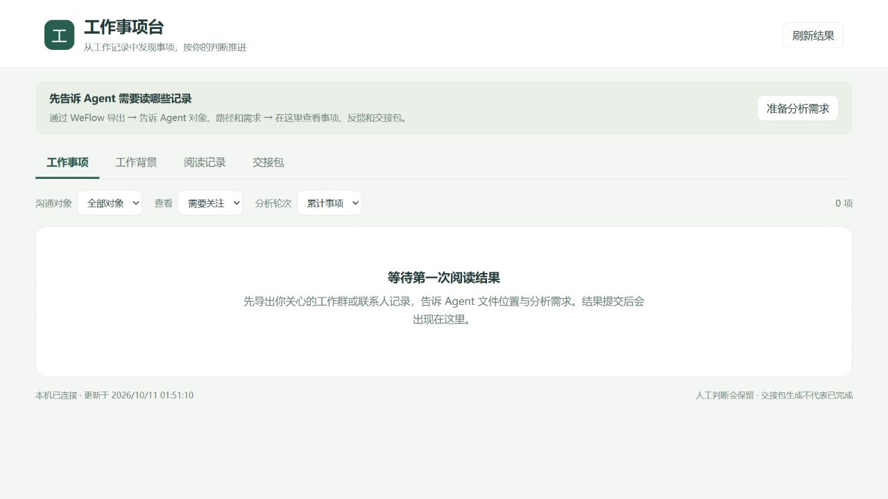

# 0.1.0 第一版验收 · 2026-10-11

## 验收结论

第一版的 Agent 提交、工作台反馈与交接底座已运行。正式服务 <http://127.0.0.1:8770/>；项目 D:\WeChatWorkDesk，独立 Python 环境 `.venv`。

所有测试采用临时模拟材料。正式工作台的对象、导出登记、阅读轮次、背景、事项与交接包均为 0 条。没有导入 D:\WeChatRecord，未调用模型、发送微信消息、创建其他任务或改动 WeChatAgent/WeFlow。

## 已验证

- 21 项自动化检查全部通过，末轮耗时 4.787 秒。
- 原文件不被修改，后续变化不改变历史快照；重导出相同文件复用，相同文件名的新内容保存为新版本。
- 未登记对象不能启动阅读；提交须逐文件声明覆盖，未读文件不能作依据，错误归属/格式拒绝且不会部分写入。
- 相同结果重复提交幂等；已发布结果不能覆盖。模型不能直接写已完成状态。
- 同事项更新保留人工完成/无关等判断；内容变化另作提示。未出现在下一轮不自动完成。
- 人工修订有版本校验；旧页面反馈和旧事项版本的交接请求会被拒绝。
- 暂缓要求未来且带时区的再次关注时间；背景只有确认后才进入下次上下文，可纠正或清除已核实的疑问。
- 交接包包含材料定位和反馈，保留到重启后；生成不会改变完成状态。
- 实际本机 HTTP 的状态、反馈、下载以及跨来源/错误主机拒绝验证通过。
- JavaScript 语法检查及 Python 编译检查通过。

## 浏览器交互

在隔离模拟服务上，实际完成事项展开、完成判断、已完成筛选、背景职责纠正和确认、清除背景疑问、交接包生成、阅读覆盖及原始结果查看。

已完成事项的旧行动建议和疑问折叠为历史内容；避免与人工完成判断冲突。正式空白页面通过实际浏览器读取和截图核对。

模拟服务已停止；正式页面保留，正式数据库没有模拟事项。

## 启动与停止

验证正常启动、重复启动复用同一进程、停止后无端口监听、再次启动恢复。Windows 虚拟环境可能由子进程实际监听端口；启动器记录并核对实际服务进程，避免只停止外层启动进程而遗留服务。遇到其他端口占用者不会将其停止。

## 尚未验收的能力

- 首批真实导出的格式、文件/附件覆盖、阅读成本和实际事项准确率；需要用户指定样本后验收。
- 第一版由 Agent 使用文件工具阅读并提交，未内置 WeFlow 格式解析、模型调用、自动导出或消息级自动差异解析。
- 语义去重、跨群合并、更正识别和自动认知学习属于后续版本；当前依赖明确稳定标识和人工核对。
- 未启用与 WeChatAgent 的知识共享，也未自动创建外部执行任务。
